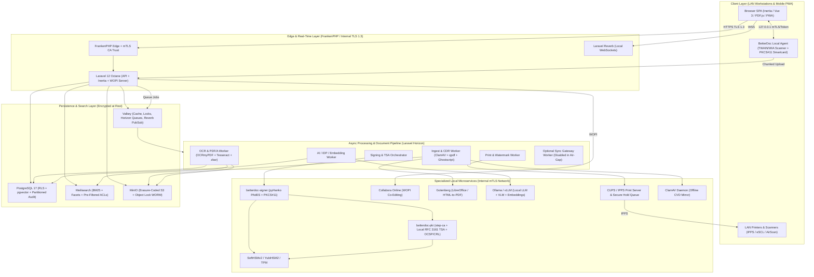
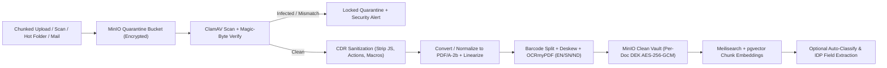

# BetterDoc DMS — System Architecture Document

**Document ID:** `BETTERDOC-ARCH-001`  
**Status:** Proposed (Awaiting Approval)  
**Target Stack:** PHP 8.4 / Laravel 12 (FrankenPHP Octane) · Inertia.js + Vue 3 + TypeScript + Tailwind CSS + shadcn-vue · PostgreSQL 17 (`pgvector`, RLS, Partitioning) · Meilisearch · Valkey · MinIO · `betterdoc-signer` (pyHanko + PKCS#11) · `step-ca` + SoftHSM2 · Ollama · Collabora Online · CUPS · ClamAV · Gotenberg · OCRmyPDF

---

## 1. Architectural Vision & Design Principles

**BetterDoc DMS** is a **LAN-first, offline-complete** Document Management, Security Governance, and Workflow Automation platform engineered for environments where external internet connectivity is unavailable, unreliable, or legally forbidden (air-gapped defence networks, branch-based financial institutions, government ministries, and corporate offices experiencing power/link outages).

### Core Non-Negotiable Principles
1. **Zero Internet Dependency:** Every runtime capability—authentication, MFA, PDF rendering, PAdES digital signing, RFC 3161 time-stamping, OCSP/CRL revocation checks, OCR, AI classification/RAG/translation, office co-editing, printing, scanning, and monitoring—executes completely inside the local network.
2. **Defense-in-Depth Security (MAC + RBAC + ABAC + RLS):** Clearance enforcement does not rely on a single Laravel Policy check. It is enforced redundantly at the **API/Policy layer**, **PostgreSQL Row-Level Security (RLS)**, **Search pre-filtering**, **Storage encryption keys**, **WebSocket channel authorization**, and **Print/Export watermarking**.
3. **Crash & Load-Shedding Tolerance:** Every mutation follows a write-ahead outbox and idempotent job-state machine so abrupt power loss never corrupts files, leaves ghost search records, or breaks audit chains.
4. **Profile-Driven Single Codebase:** Defence, Financial, and Corporate deployments run identical application code driven by signed, versioned **Organisation Configuration Profiles**.
5. **Low-Bandwidth & Legacy-Hardware Performance:** Inertia.js minimizes JSON payloads, PDF.js streams linearized pages via HTTP Range requests, static assets are locally compressed (Brotli/Zstd via FrankenPHP), and heavy OCR/AI runs asynchronously on worker nodes.

---

## 2. High-Level System Topology

---

## 3. Bounded Contexts & Service Responsibilities

### 3.1 Core Application (`betterdoc-core` — Laravel 12 + FrankenPHP)
- **Identity & Access Context:** Local users, LDAP/FreeIPA/AD sync, optional OIDC/SAML, MFA (TOTP, WebAuthn/FIDO2, Smartcard), OrgUnit nested-set/ltree hierarchy, Clearance Ladder, Compartments, RBAC (`spatie/laravel-permission`), ABAC Policy Decision Point (`ClearancePolicyEngine`), Two-Person Approval workflow, Break-Glass sessions.
- **Document & Records Vault:** Cabinets/Folders, Smart Views, Documents, Immutable Document Versions, Check-in/Check-out locks, Metadata Schemas, Tags, Legal Holds, Retention Schedules, Disposition Reviews, Correspondence Registry (Incoming/Outgoing numbers, bring-up docket, physical folio tracking).
- **Collaboration & Viewer Context:** PDF.js viewer API (Range streaming, dynamic watermark token), PDF Annotation & True Destructive Redaction, Comments & `@mentions` (clearance-checked before emitting notifications!), WOPI host endpoints for Collabora Online.
- **Workflow Engine:** Visual BPMN-lite graph definitions (Start, User Approval, Parallel Fork/Join, Conditional Gateway, Escalation/SLA Timer, Auto-Classify/Extract, Seal & Sign, Registry Dispatch, Archive/WORM), Task Inbox, Delegation, Forms.
- **Finance & Business Modules:** AP Automation (Vendor, PO, GRN, 2/3-way match, duplicate check, UBL 2.1 / PEPPOL export, ZIMRA fiscalisation hook), Contract Lifecycle (obligations, renewal alerts, clause library), HR Personnel Vault (compartmentalized employee records), Compliance Pack Generator.
- **Immutable Audit Context:** Hash-chained append-only `audit_events` partitioned by month, signed `audit_checkpoints`, Syslog/SIEM RFC 5424 exporter.

### 3.2 PKI, Hardware Security & PAdES Signing (`betterdoc-pki` + `betterdoc-signer`)
- **Offline Root CA:** Created during bootstrap ceremony; private key stored offline (encrypted USB/HSM), never mounted on the running server.
- **Online Intermediate CA (`step-ca`):** Issues internal mTLS service certs (24h–30d auto-renewed), user X.509 signing certs (`digitalSignature`, `nonRepudiation`), TSA cert (`timeStamping`), and OCSP responder cert (`OCSPSigning`).
- **HSM Custody (`SoftHSMv2` / `YubiHSM2` / `PKCS#11`):** CA keys and server-managed user signing keys reside inside PKCS#11 slots. Private keys are flagged `CKA_EXTRACTABLE = FALSE` and never appear in PostgreSQL or filesystem dumps.
- **`betterdoc-signer` (Python FastAPI + `pyHanko`):**
  - **Tier 1 (Simple Stamp):** Visual graphic/typed stamp + SHA-256 document hash anchored in the immutable audit ledger.
  - **Tier 2 (Advanced X.509 PAdES-B-LT / LTA):** Embeds visible signature appearance + QR verification code, RFC 3161 timestamp from `betterdoc-tsa`, and CRL/OCSP responses in PDF `/DSS` (Document Security Store) for long-term offline validation in third-party readers (Adobe Acrobat, Foxit, LibreOffice).
  - **Tier 2B (Client Hardware Token / Smartcard Signing):** `betterdoc-signer` prepares the PDF byte-range & SHA-256/512 digest, sends the digest to `BetterDoc Local Agent`, the user's USB token/smartcard signs locally via PKCS#11, and `betterdoc-signer` finalizes the CMS/PAdES structure + TSA + DSS.
  - **Tier 3 (Workflow Approval Signature):** Cryptographic workflow attestation chained into the audit log + optional sealing PAdES signature on final approval.

### 3.3 Document Ingestion, Malware, CDR & OCR Pipeline
Every file enters via a strict **Zero-Trust Quarantine Funnel**:

- **Resumable Uploads (200MB+ & Load-Shedding Safe):** Chunked uploads (5MB parts) tracked in `upload_sessions` with per-chunk SHA-256 verification and S3 multipart state. If power drops at 140MB, the client queries `GET /uploads/{id}` and resumes from chunk 29.
- **True Redaction:** Annotation redaction marks coordinates; committing runs `PyMuPDF` (`apply_redactions()`) / raster verification to physically strip underlying text glyphs, images, and PDF metadata in redacted boxes, producing a sanitized new version or derivative share copy.

### 3.4 Print & Scan Subsystems
- **Print Pipeline:**
  - Printers registered/discovered via CUPS (`avahi` mDNS or static IPPS).
  - Watermark engine stamps `USER_NAME | SERVICE_NO | CLASSIFICATION | TIMESTAMP | IP | JOB_ID` diagonally across every page before spooling.
  - **Secure Print Release:** Jobs default to `HELD` (`print_jobs.status = 'held'`) with a 6-digit one-time PIN (or NFC/RFID card lookup). User authenticates at the release station/MFP portal -> CUPS transmits via IPPS -> audit entry written (`print.released`), quota deducted against cost centre.
- **Scan Pipeline:**
  - Server pulls from LAN MFPs via `sane-airscan` (eSCL) or watches local SMB/SFTP/IMAP dropboxes (`scan_hot_folders`).
  - Workstation USB scanners connect via `BetterDoc Local Agent` over `127.0.0.1`.
  - **Barcode Separator Sheets:** `zbar` detects BetterDoc Code128/QR separator pages to automatically split a 50-page feeder stack into distinct documents, populate metadata (e.g., DocType = Invoice, Unit = HQ-Finance), and push into the OCR/IDP queue.

### 3.5 Local-First AI, IDP & Security-Filtered RAG
- **Inference Engine:** Ollama (or vLLM on multi-GPU nodes) bound exclusively to the internal Docker/LAN network. Air-gapped mode blocks all cloud AI plugin registrations at boot (`BetterDocServiceProvider` refuses startup if `AIR_GAPPED=true` and an external AI endpoint is configured).
- **Pre-Retrieval Clearance Enforcement:**
  1. User submits query -> Laravel initiates PostgreSQL transaction with `SET LOCAL` security context (`user_id`, `clearance_rank`, `compartments`, `unit_path`).
  2. Query text is embedded locally via `bge-m3`.
  3. **Hybrid Retrieval** executes:
     - **Semantic:** `pgvector` HNSW search with `hnsw.iterative_scan = strict_order` inside the RLS-enforced transaction.
     - **Lexical:** Meilisearch query with mandatory injected server filter (`classification_rank <= user_rank AND required_compartments NOT IN denied_compartments AND ...`), followed by PostgreSQL RLS hydration check.
  4. **High-Water-Mark Escalation:** The AI chat turn and any generated summary/draft automatically inherit `MAX(classification_rank)` and `UNION(compartments)` of all retrieved source chunks, preventing "classification laundering" via AI summarization!
  5. **Attribution & Audit:** Every prompt, retrieved chunk IDs, model version, latency, and generated response hash is logged to `ai_audit_logs` + `audit_events`. Zero model training on tenant data.

---

## 4. Air-Gap Enforcement, Load-Shedding Resilience & Sync Gateway

### 4.1 Air-Gapped Mode (`BETTERDOC_AIR_GAPPED=true`)
1. **Build-Time Gate:** `npm run build:verify-airgap` parses all generated `.js`, `.css`, `.html`, and `.svg` artifacts in `public/build` and fails CI/build if any external `http://` or `https://` reference (CDN, Google Fonts, Gravatar, analytics) is present.
2. **Runtime Network Isolation:** Docker Compose `internal: true` bridge network for backend services (Postgres, Valkey, MinIO, Signer, Ollama, Meilisearch) + explicit egress firewall rule (`nftables`/`iptables`) dropping all non-RFC1918 / non-LAN outbound traffic from application containers.
3. **Application Guardrails:** PHP HTTP client wrapper (`BetterDocHttpClient`) intercepts all outbound requests and throws `AirGapViolationException` unless the target is on the explicit local service allowlist (`betterdoc-signer`, `ollama`, `collabora`, `cups`, `meilisearch`, `minio`, `betterdoc-pki`) or (when air-gap is disabled) explicitly allowlisted webhook/sync endpoints.
4. **Offline Distribution Bundle:** Built via `scripts/build-offline-bundle.sh` producing a SHA-256 signed ISO/USB archive containing: container images (`docker save` compressed `.tar.zst`), Ollama GGUF model blobs, Tesseract `tessdata` (`eng`, `sna`, `nde`), ClamAV `.cvd` databases, Ansible playbooks, and OS packages.

### 4.2 Load-Shedding & Power-Loss Resilience
- PostgreSQL configured with `synchronous_commit = on`, `full_page_writes = on`, `wal_level = replica`.
- All multi-step pipelines (Upload -> Scan -> CDR -> OCR -> Index -> AI) persist state transitions in `processing_jobs` with **idempotency keys** (`sha256(version_id + stage)`).
- On boot (`betterdoc:recover-interrupted`), an orchestrator scans for jobs stuck in `in_progress` whose worker lease in Valkey expired, verifies partial MinIO objects, cleans orphan temp objects, and re-enqueues safely without duplicating versions or billing pages twice.
- Optional **APC/NUT UPS Integration Hook:** Listens for `upsd` low-battery signals to pause non-essential AI/OCR workers, flush Horizon queues gracefully, switch UI banner to "Backup Power — Read/Critical Mode", and execute clean DB checkpoint before shutdown.

### 4.3 Optional Sync Gateway (Disabled in Air-Gap)
- Uses a transactional outbox table (`sync_outbox`) capturing version deltas, metadata updates, and tombstone revocations.
- **Classification Ceiling Policy:** A hard site policy `sync.max_classification_rank` prevents `Secret` / `Top Secret` (or any configured ceiling) from ever being queued to cloud object storage. Site-to-site replication over WireGuard/IPsec VPN supports full classification ranges between equally cleared on-prem clusters.
- **Conflict Resolution:** Vector clocks / monotonic version counters per document; concurrent offline edits on two disconnected sites create explicit **conflict branches** requiring human/Records Officer reconciliation rather than silent overwrites.

---

## 5. Multi-Organisation Configuration Profiles

Profiles live as validated YAML/JSON packs (`config/profiles/{defence,financial,corporate}.yaml`) loaded into `organization_profiles` during provisioning and editable (within security floor constraints) via Admin Settings:

| Capability / Setting | Defence Profile (e.g. AFZ) | Financial Profile (e.g. Golden Knot) | Corporate / SME Profile |
| :--- | :--- | :--- | :--- |
| **Default Hosting Mode** | Air-Gapped On-Prem | LAN + Optional Encrypted Cloud Backup | LAN / Hybrid / Cloud |
| **Clearance Ladder** | `Unclassified` (0) < `Restricted` (1) < `Confidential` (2) < `Secret` (3) < `Top Secret` (4) | `Public` (0) < `Internal` (1) < `Confidential` (2) < `Restricted` (3) | `Public` (0) < `Internal` (1) < `Confidential` (2) |
| **Bell-LaPadula Mode** | Strict No-Read-Up **+ No-Write-Down** | Strict No-Read-Up (Advisory Write-Down guard) | Strict No-Read-Up |
| **Compartments** | Mandatory (`OPS`, `INTEL`, `PERS`, `LOG`, `TECH`, `FIN`) | Enabled (`KYC_AML`, `CREDIT`, `TREASURY`, `AUDIT`, `HR`) | Optional |
| **Two-Person Rule** | Mandatory for `Confidential+` declassify/delete/ACL | Mandatory for `Restricted` & AP > threshold | Optional / Admin-configurable |
| **Signing Custody** | Smartcard / YubiHSM2 / PKCS#11 required | HSM / SoftHSM + Step-Up WebAuthn | SoftHSM / Drawn Stamp + Audit |
| **Print Default** | Mandatory Secure Print Hold (PIN/Badge) + Dynamic Watermark | Secure Hold for `Confidential+` + Watermark | Direct Print allowed for `Public`/`Internal` |
| **Correspondence Registry** | Enabled (Signal/Minute/Registry numbering, Bring-Up) | Optional (Customer Correspondence Log) | Optional |
| **Finance / AP / E-Invoicing** | Optional (Procurement module toggle) | **Enabled** (3-Way Match, ZIMRA hooks, UBL/PEPPOL, KYC Packs) | Enabled (Simplified Invoice Flow) |
| **Cloud AI / Sync** | Hard-Blocked (`AIR_GAPPED=true`) | Sync allowed up to `Internal`; Local AI only by default | Configurable |

---

## 6. Hosting Modes

1. **Mode 1 — Air-Gapped On-Prem (Default for Defence):**
   - Single-node Docker Compose (`docker-compose.yml` + `docker-compose.airgap.yml`) or multi-node `k3s` cluster installed from offline USB/ISO bundle.
   - `BETTERDOC_AIR_GAPPED=true`, local `step-ca`, local Ollama, local ClamAV mirror, physical printer/scanner LAN VLAN.
2. **Mode 2 — LAN + Optional Cloud Backup/Portal (Financial / Corporate):**
   - Primary server runs inside office/branch LAN so branches operate even if fiber/internet drops.
   - Encrypted `Sync Gateway` pushes backups (envelope-encrypted via customer KEK) and low-classification replication to Laravel Cloud / S3-compatible bucket. Optional remote portal via WireGuard / Cloudflare Zero-Trust / reverse SSH tunnel (never exposing raw internal services).
3. **Mode 3 — Full Cloud (Corporate / Unclassified SaaS):**
   - Deployed on Laravel Cloud (app + managed PostgreSQL + S3 Object Storage).
   - **Hard Policy Guardrail:** System displays a persistent compliance banner and **blocks** creating or importing classification levels marked `requires_on_prem = true` (e.g. `Secret`, `Top Secret`, `Defence`), documenting that classified data must NOT reside in multi-tenant/public cloud mode.

---

## 7. Architecture Decision Records (ADRs)

| ADR | Decision | Rationale & Alternatives Rejected |
| :--- | :--- | :--- |
| **ADR-001** | **Use `pyHanko` + `python-pkcs11` in `betterdoc-signer` microservice over EU DSS (Java) or PHP TCPDF.** | TCPDF lacks PAdES-B-LT/LTA (`/DSS`, `/VRI`, RFC 3161 document timestamps, incremental multi-party signing). EU DSS requires a heavy JVM (~1GB RAM) unsuitable for constrained office hardware. `pyHanko` (MIT) runs in ~80MB RAM, natively supports PAdES-B/T/LT/LTA, PKCS#11 HSM/smartcards, and external digest signing. An internal `PdfSignerInterface` preserves swappability to EU DSS if an organisation legally mandates it. |
| **ADR-002** | **Use `step-ca` + SoftHSMv2/YubiHSM2 + dedicated RFC 3161 TSA & OCSP microservices (`betterdoc-pki`).** | `step-ca` handles offline root + intermediate ACME/mTLS/X.509 issuance cleanly with PKCS#11 KMS support, while dedicated lightweight TSA (`timeStamping` EKU) and OCSP/CRL responders fill RFC 3161 & revocation gaps without external CA dependencies. |
| **ADR-003** | **Use Meilisearch (BM25 + facets) paired with PostgreSQL `pgvector` (HNSW iterative scan) instead of OpenSearch as default.** | OpenSearch requires 2–4GB+ JVM heap baseline just to sit idle, hurting older office hardware. Meilisearch consumes <200MB RAM idle, searches 100k docs in <50ms, and enforces server-injected pre-retrieval security filters (`classification_rank <= R` and `required_compartments NOT IN denied`). `pgvector` 0.8+ with `hnsw.iterative_scan = strict_order` executes vector similarity directly inside PostgreSQL RLS transactions. An OpenSearch Scout driver remains configurable for >5M doc clusters. |
| **ADR-004** | **Enforce PostgreSQL Row-Level Security (RLS) via transaction-scoped `SET LOCAL` per Octane request & Horizon job.** | FrankenPHP Octane reuses PHP workers and persistent DB connections across requests. Session-level `SET` risks cross-request clearance leakage. A mandatory `DbSecurityContext` middleware opens/wraps DB context with `SET LOCAL betterdoc.*` and resets on termination, verified by automated concurrency leakage tests. |
| **ADR-005** | **Use Collabora Online (CODE) as primary offline WOPI co-editing engine (ONLYOFFICE optional adapter).** | Collabora CODE (MPL-2.0) has no artificial 20-connection Community Edition ceiling, integrates cleanly via WOPI, and runs strictly offline. ONLYOFFICE remains supported via the same WOPI adapter for orgs preferring its UI. |
| **ADR-006** | **Implement custom append-only hash-chained `audit_events` + signed checkpoints instead of relying solely on stock `spatie/laravel-activitylog`.** | Stock `activitylog` stores mutable rows without cryptographic tamper evidence or partitioning. Keeping `audit_events` append-only (PostgreSQL trigger blocking `UPDATE`/`DELETE`), monthly partitioned, SHA-256 hash-chained (`prev_hash + canonical_payload`), and periodically signed by the HSM key provides forensic non-repudiation. |
| **ADR-007** | **Envelope encryption with per-document Data Encryption Keys (DEKs) wrapped by HSM/TPM Master Key (KEK) + optional client-side E2EE for Top Secret.** | Per-document AES-256-GCM DEKs enable instant cryptographic shredding/key rotation per document and ensure MinIO disk theft yields zero plaintext. Top-level documents can additionally wrap the DEK client-side using the recipient/compartment WebCrypto keypair. |
| **ADR-008** | **Chunked resumable uploads (5MB parts via Laravel-proxied S3 Multipart + `upload_sessions` ledger).** | 200MB+ uploads over congested LANs or frequent power cuts fail with single-POST uploads. Persisting part ETags & SHA-256 hashes in Postgres allows deterministic resume after browser refresh, Wi-Fi drop, or server reboot. |
| **ADR-009** | **High-water-mark classification inheritance on AI RAG chats and generated drafts.** | Prevents indirect covert-channel leakage where an AI summarizes a `Secret` document into an `Internal` note. Every AI response automatically computes `max(source_classifications)` and `union(source_compartments)` before persistence or export. |
| **ADR-010** | **Single-file/lightweight `BetterDoc Local Agent` (Python/Go tray service on `127.0.0.1`) for USB TWAIN/WIA scanners and PKCS#11 smartcards.** | Web browsers cannot directly invoke legacy Windows TWAIN/WIA drivers or arbitrary PKCS#11 middleware across all smartcard vendors (WebAuthn covers FIDO2, not legacy PIV/PKCS#11 PDF signing). A paired localhost agent over short-lived pairing tokens solves both cleanly without browser plugins. |
