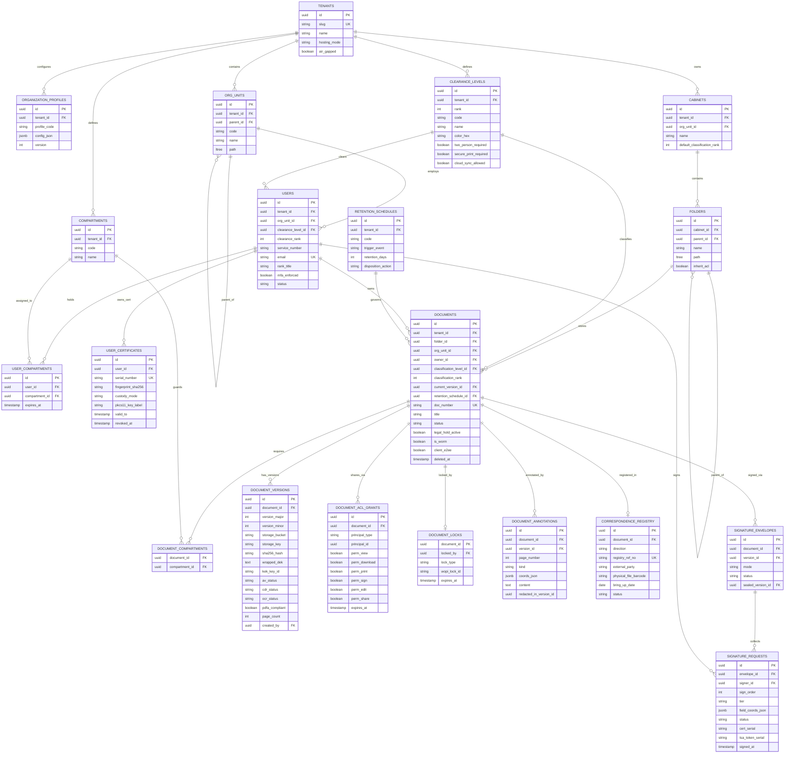

# BetterDoc DMS — Data Model & Entity-Relationship Design

**Document ID:** `BetterDoc-ERD-002`  
**Database Engine:** PostgreSQL 17 (`pgvector 0.8+`, `ltree`, `pgcrypto`, native declarative range partitioning)  
**Primary Key Strategy:** Time-ordered **UUIDv7** across application entities (`BIGINT GENERATED ALWAYS AS IDENTITY` sequence for strict monotonic `audit_events` hash chaining).

---

## 1. Core Identity, Clearance, DMS & PKI ERD



---

## 2. Workflow, Finance/AP, AI/RAG, Print & Immutable Audit ERD

```mermaid
erDiagram
    DOCUMENTS ||--o{ WORKFLOW_INSTANCES : "routed_through"
    WORKFLOW_DEFINITIONS ||--o{ WORKFLOW_INSTANCES : "instantiates"
    WORKFLOW_INSTANCES ||--o{ WORKFLOW_TASKS : "creates"

    DOCUMENTS ||--o{ DOCUMENT_CHUNKS : "indexed_as"
    DOCUMENT_VERSIONS ||--o{ IDP_EXTRACTIONS : "extracted_into"
    USERS ||--o{ AI_CHAT_SESSIONS : "converses"
    AI_CHAT_SESSIONS ||--o{ AI_CHAT_MESSAGES : "contains"

    VENDORS ||--o{ PURCHASE_ORDERS : "receives"
    PURCHASE_ORDERS ||--o{ GOODS_RECEIPTS : "fulfilled_by"
    VENDORS ||--o{ INVOICES : "bills"
    DOCUMENTS ||--o| INVOICES : "source_doc"
    DOCUMENTS ||--o| CONTRACTS : "governs"
    CONTRACTS ||--o{ CONTRACT_OBLIGATIONS : "tracks"
    USERS ||--o{ HR_EMPLOYEE_FILES : "subject_of"
    DOCUMENTS ||--o| HR_EMPLOYEE_FILES : "stored_as"

    DOCUMENTS ||--o{ PRINT_JOBS : "spooled_to"
    PRINTERS ||--o{ PRINT_JOBS : "executes"
    DOCUMENTS ||--o{ BREAK_GLASS_SESSIONS : "unlocked_by"
    TWO_PERSON_REQUESTS ||--o| BREAK_GLASS_SESSIONS : "authorizes"
    USERS ||--o{ AUDIT_EVENTS : "triggers"

    WORKFLOW_DEFINITIONS {
        uuid id PK
        uuid tenant_id FK
        string key
        int version
        jsonb bpmn_graph_json
        boolean is_active
    }
    WORKFLOW_INSTANCES {
        uuid id PK
        uuid definition_id FK
        uuid document_id FK
        uuid started_by FK
        jsonb current_nodes_json
        string status
        timestamp sla_due_at
    }
    WORKFLOW_TASKS {
        uuid id PK
        uuid instance_id FK
        string node_id
        uuid assignee_id FK
        uuid delegated_to_id FK
        string status
        string decision
        jsonb form_data_json
        timestamp due_at
    }
    DOCUMENT_CHUNKS {
        uuid id PK
        uuid tenant_id FK
        uuid document_id FK
        uuid version_id FK
        int classification_rank
        string required_compartments_arr
        uuid org_unit_id
        string acl_principals_arr
        int chunk_index
        text content_text
        vector embedding
    }
    IDP_EXTRACTIONS {
        uuid id PK
        uuid document_version_id FK
        string model_name
        string detected_doc_type
        jsonb extracted_fields_json
        float overall_confidence
        string review_status
    }
    AI_CHAT_SESSIONS {
        uuid id PK
        uuid user_id FK
        int high_water_rank
        jsonb high_water_compartments
        timestamp created_at
    }
    AI_CHAT_MESSAGES {
        uuid id PK
        uuid session_id FK
        string role
        text content
        jsonb cited_doc_ids
        string model_used
    }
    VENDORS {
        uuid id PK
        uuid tenant_id FK
        string code UK
        string name
        string tax_id_zimra
        string risk_tier
    }
    PURCHASE_ORDERS {
        uuid id PK
        uuid vendor_id FK
        string po_number UK
        string currency
        numeric total_amount
        string status
    }
    GOODS_RECEIPTS {
        uuid id PK
        uuid po_id FK
        string grn_number UK
        timestamp received_at
    }
    INVOICES {
        uuid id PK
        uuid vendor_id FK
        uuid document_id FK
        uuid po_id FK
        string invoice_no
        numeric total_amount
        string match_status
        string zimra_fiscal_status
        string zimra_receipt_no
    }
    CONTRACTS {
        uuid id PK
        uuid document_id FK
        string counterparty
        date start_date
        date end_date
        int renewal_notice_days
        string status
    }
    CONTRACT_OBLIGATIONS {
        uuid id PK
        uuid contract_id FK
        string title
        date due_date
        uuid assignee_id FK
        string status
    }
    HR_EMPLOYEE_FILES {
        uuid id PK
        uuid user_id FK
        uuid document_id FK
        string category
        boolean restricted_from_subject
    }
    PRINTERS {
        uuid id PK
        uuid tenant_id FK
        string name
        string ipps_uri
        int max_classification_rank
        boolean supports_secure_release
    }
    PRINT_JOBS {
        uuid id PK
        uuid document_id FK
        uuid user_id FK
        uuid printer_id FK
        string cost_centre_code
        int pages
        string release_pin_hash
        string status
    }
    TWO_PERSON_REQUESTS {
        uuid id PK
        uuid tenant_id FK
        string action_type
        string target_type
        uuid target_id
        uuid requested_by FK
        uuid approved_by FK
        string status
        jsonb payload_json
    }
    BREAK_GLASS_SESSIONS {
        uuid id PK
        uuid user_id FK
        uuid document_id FK
        uuid two_person_request_id FK
        text justification
        timestamp expires_at
    }
    AUDIT_EVENTS {
        bigint seq_id PK
        uuid tenant_id FK
        timestamp occurred_at
        uuid actor_user_id FK
        string actor_ip
        string event_type
        string resource_type
        uuid resource_id
        int classification_rank
        jsonb before_json
        jsonb after_json
        string prev_hash
        string entry_hash
    }
```



---

## 3. PostgreSQL Row-Level Security (RLS) & Hardening DDL

### 3.1 Transaction-Scoped Security Context
On every authenticated HTTP request or Horizon worker job, Laravel starts/wraps execution in a database transaction setting session-local GUCs (`SET LOCAL`) so connection pooling under FrankenPHP Octane can **never** bleed clearance state across requests:

```sql
-- Executed inside transaction scope via DbSecurityContext middleware
SET LOCAL betterdoc.tenant_id = '01933a10-...';
SET LOCAL betterdoc.user_id = '01933a12-...';
SET LOCAL betterdoc.clearance_rank = '2'; -- e.g. Confidential
SET LOCAL betterdoc.compartments = 'OPS,FIN'; -- Comma-separated active user compartments
SET LOCAL betterdoc.org_unit_path = 'afz.hq.ops';
SET LOCAL betterdoc.is_auditor = 'false';
SET LOCAL betterdoc.break_glass_doc_ids = ''; -- Approved active break-glass UUIDs only
```

### 3.2 Mandatory RLS Policy on `documents` & `document_chunks`
Even if an application query misses an Eloquent scope, PostgreSQL itself enforces MAC + Compartment Subset + Ownership/Unit/Grant/Break-Glass:

```sql
ALTER TABLE documents ENABLE ROW LEVEL SECURITY;
ALTER TABLE documents FORCE ROW LEVEL SECURITY;

CREATE POLICY documents_mac_abac_select ON documents
FOR SELECT
USING (
    tenant_id = NULLIF(current_setting('betterdoc.tenant_id', true), '')::uuid
    AND deleted_at IS NULL
    AND (
        -- Emergency break-glass override (time-bounded & dual-approved)
        id = ANY(string_to_array(NULLIF(current_setting('betterdoc.break_glass_doc_ids', true), ''), ',')::uuid[])
        OR (
            -- 1. Mandatory Access Control (Bell-LaPadula No-Read-Up)
            classification_rank <= COALESCE(NULLIF(current_setting('betterdoc.clearance_rank', true), '')::int, -1)
            -- 2. Compartment Superset Check (every doc compartment must be in user's compartments)
            AND NOT EXISTS (
                SELECT 1 FROM document_compartments dc
                WHERE dc.document_id = documents.id
                  AND dc.compartment_id <> ALL(
                      string_to_array(NULLIF(current_setting('betterdoc.compartment_ids', true), ''), ',')::uuid[]
                  )
            )
            -- 3. Explicit Grant / Ownership / Org-Unit Hierarchy / HR Subject Shield
            AND (
                owner_id = NULLIF(current_setting('betterdoc.user_id', true), '')::uuid
                OR EXISTS (
                    SELECT 1 FROM document_acl_grants g
                    WHERE g.document_id = documents.id
                      AND g.perm_view = true
                      AND (g.expires_at IS NULL OR g.expires_at > now())
                      AND (
                          (g.principal_type = 'user' AND g.principal_id = NULLIF(current_setting('betterdoc.user_id', true), '')::uuid)
                          OR (g.principal_type = 'org_unit' AND g.principal_id = ANY(string_to_array(current_setting('betterdoc.ancestor_unit_ids', true), ',')::uuid[]))
                          OR (g.principal_type = 'role' AND g.principal_id = ANY(string_to_array(current_setting('betterdoc.role_ids', true), ',')::uuid[]))
                      )
                )
                OR EXISTS (
                    SELECT 1 FROM org_units ou
                    WHERE ou.id = documents.org_unit_id
                      AND ou.path <@ NULLIF(current_setting('betterdoc.org_unit_path', true), '')::ltree
                      AND documents.unit_wide_readable = true
                )
            )
            -- 4. HR Disciplinary/Medical Subject Shield
            AND NOT EXISTS (
                SELECT 1 FROM hr_employee_files hr
                WHERE hr.document_id = documents.id
                  AND hr.restricted_from_subject = true
                  AND hr.user_id = NULLIF(current_setting('betterdoc.user_id', true), '')::uuid
            )
        )
    )
);
```

> **Same RLS Pattern on `document_chunks`:** `document_chunks` mirrors `classification_rank`, `required_compartment_ids uuid[]`, `acl_principal_keys text[]`, and `org_unit_path ltree` directly on the chunk row so `pgvector` HNSW scans evaluate security **during** index traversal without expensive cross-table joins on 1M+ chunks.

---

## 4. Partitioning, Indexing & 100k+ Document Performance Strategy

1. **`audit_events` Monthly Partitioning + Immutability Triggers:**
   - Declarative `PARTITION BY RANGE (occurred_at)` creating `audit_events_YYYY_MM` partitions automatically via scheduled Laravel/pg_cron maintenance job.
   - Trigger `prevent_audit_mutation` (`BEFORE UPDATE OR DELETE ON audit_events`) raises `SQLSTATE '42501'` (`audit_events is append-only`).
   - `seq_id` + `prev_hash` + `entry_hash = encode(sha256(...), 'hex')` forms an unbroken cryptographic hash chain; `audit_checkpoints` anchors each 10,000 events / hourly snapshot with an HSM ECDSA signature.
2. **100k-Document Search & Query Budget (< 1 second):**
   - `documents` indexed on `(tenant_id, classification_rank, folder_id, deleted_at)`, GIN index on `metadata_jsonb`, `ltree` GiST index on `org_units.path`.
   - `document_chunks` uses `pgvector` **HNSW** (`m = 16, ef_construction = 64`, `vector_cosine_ops`) with `SET LOCAL hnsw.iterative_scan = strict_order` so top-K RAG retrieval returns cleared matches cleanly even for low-clearance users.
   - **Meilisearch Index (`betterdoc_documents`):** Indexed fields: `id`, `tenant_id`, `title`, `doc_number`, `ocr_text`, `tags`, `metadata_flat`. Filterable fields: `classification_rank`, `required_compartments`, `acl_principals`, `org_unit_ancestors`, `status`, `doc_type`, `created_at_ts`. Target P95 query latency at 100k docs: **< 45ms**.

---

## 5. MinIO Object Storage Layout & Envelope Encryption

| Bucket | Object Lock (WORM) | Purpose | Encryption |
| :--- | :--- | :--- | :--- |
| `betterdoc-quarantine` | Off (7d lifecycle cleanup) | Raw incoming uploads prior to ClamAV & CDR | Server-side SSE-KMS (local KMS) |
| `betterdoc-vault` | Governance / Compliance Mode (per retention policy) | Verified clean documents, PDF/A versions, sealed signed PDFs | **Per-Document DEK (AES-256-GCM)** wrapped by HSM Master KEK |
| `betterdoc-thumbnails` | Off | Encrypted rasterized page thumbnails (streamed only after doc RLS check) | Per-Document DEK |
| `betterdoc-backups` | Compliance Mode | Encrypted `pg_basebackup` / WAL archives & MinIO mirror bundles | Offline Backup Public Key (Age/Libsodium) |

- **Object Key Format:** `tenants/{tenant_id}/docs/{doc_uuid}/v{major}_{minor}_{version_uuid}.enc` (no document title or classification leaked into filesystem/object paths!).
