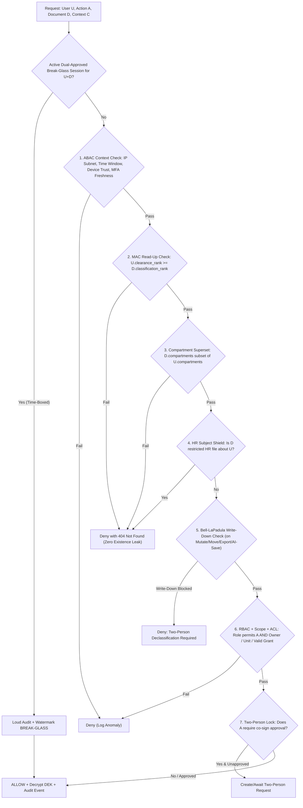

# SENTINEL DMS — Permission Matrix & Access Control Specification

**Document ID:** `SENTINEL-IAM-003`  
**Security Model:** Mandatory Access Control (Bell-LaPadula MAC) $\cap$ Role-Based Access Control (RBAC) $\cap$ Attribute-Based Access Control (ABAC) $\cap$ Discretionary/Explicit Grants (DAC)

---

## 1. Access Evaluation Algorithm (Policy Decision Point)

Every read, write, search, print, sign, share, AI query, and WebSocket event invokes `ClearancePolicyEngine::authorize(User, Action, Resource, Context)`. Evaluation is **deny-by-default** and short-circuits in strict order:

### Critical Invariants
1. **Separation of Duty (Admin $\neq$ Cleared Reader):** A System `Admin` with `Internal` clearance can manage users, printers, and backups, **never** read `Confidential`, `Secret`, or `Top Secret` documents unless independently vetted with that clearance and compartments.
2. **Existence Hiding (`404` vs `403` Oracle Prevention):** When Step 2, 3, or 4 fails on direct URL/API access (`/documents/{uuid}`, `/thumbnails/{uuid}`, `/api/v1/documents/{uuid}`), SENTINEL returns **`404 Not Found`** with a generic body, identical to a non-existent UUID. It never reveals title, classification, owner, or existence.
3. **Configurable Bell-LaPadula No-Write-Down (`*-property`):**
   - **Defence Profile (Enforced):** A user operating on a `Secret` document cannot move it into an `Internal` folder, copy extracted content into an `Unclassified` correspondence draft, or save an AI summary referencing `Secret` sources at `Internal`. Lowering classification requires the **Two-Person Declassification Workflow**.
   - **Financial / Corporate Profile (Advisory / Guarded):** Moving or saving into a lower-classified folder triggers a blocking warning requiring explicit confirmation + audit justification (or two-person approval for `Restricted`).

---

## 2. Role × Action Permission Matrix (RBAC Layer)

*Note: All document-level actions below remain **gated by MAC clearance & compartments** at all times.*

| Capability / Action | System Admin | Records Officer | Approver | Author | Reader | Auditor |
| :--- | :---: | :---: | :---: | :---: | :---: | :---: |
| **System Config / Profiles / Printers / CA** | Allow | — | — | — | — | Read-Only |
| **Manage Users & Role Assignments** | Allow | — | — | — | — | Read-Only |
| **Assign Clearance / Compartments** | Req 2-Person | Req 2-Person | — | — | — | Read-Only |
| **Create Cabinet / Folder / Metadata Schema** | — | Allow | — | Unit Only | — | — |
| **Upload / Capture / Scan Document** | — | Allow | Allow | Allow | — | — |
| **View Document & Stream PDF** | MAC-Gated | MAC-Gated | MAC-Gated | MAC-Gated | MAC-Gated | Metadata Only* |
| **Check-Out / Edit / Upload Version / Redact** | — | Allow | Own/Unit | Own/Grant | — | — |
| **Apply PAdES / Tier 1–3 Signature** | — | If Signer | Allow | If Signer | If Signer | — |
| **Share / Grant Document ACL** | — | Allow | Unit/Own | Own (if permitted) | — | — |
| **Print Document (if `perm_print`)** | — | MAC-Gated | MAC-Gated | MAC-Gated | If Granted | — |
| **Manage Retention / Legal Hold / WORM** | — | Allow | — | — | — | Read-Only |
| **Declassify / Delete Sensitive Doc** | — | Initiate 2P | Co-Approve 2P | — | — | — |
| **Approve Break-Glass Request** | Co-Approve (2P) | Co-Approve (2P) | Co-Approve (2P) | — | — | Alerted Live |
| **Approve Workflow / AP Invoice** | — | — | Allow | — | — | — |
| **View Tamper-Evident Audit Chain & SIEM** | Config Only | Unit Scope | — | — | — | **Full Chain*** |
| **Verify Audit Checkpoints & Export Compliance** | — | — | — | — | — | Allow |

*\*Auditor View Rule: Auditors inspect every `audit_events` row and hash chain integrity across the entire system, **but** document titles/snippets inside audit payloads for documents above the Auditor's own MAC clearance are automatically masked (`[REDACTED - CLEARANCE RANK 3]`) while cryptographic IDs and hashes remain verifiable.*

---

## 3. Classification Ladder & Controls Matrix (Default Profiles)

### 3.1 Defence Profile Ladder
| Rank | Label | Colour | Dynamic Watermark | Print Default | Share Ceiling | Cloud Sync | E2EE Option | Two-Person Rule |
| :---: | :--- | :--- | :---: | :--- | :--- | :---: | :---: | :---: |
| `0` | **Unclassified** | `#475569` Slate | Optional | Direct or Hold | Any active user | Allowed (if non-airgap) | No | No |
| `1` | **Restricted** | `#0284C7` Blue | Footer Stamp | Hold (PIN) | Unit / Explicit Grant | Blocked | No | Delete only |
| `2` | **Confidential** | `#D97706` Amber | Diagonal Full-Page | Secure Hold (PIN/Badge) | Explicit Cleared User | **Forbidden** | Optional | Declassify, Delete, ACL |
| `3` | **Secret** | `#DC2626` Red | Dynamic Anti-Screenshot | Secure Hold + Cleared Printer Only | Explicit Cleared + Compartment | **Forbidden** | Recommended | All sensitive ops |
| `4` | **Top Secret** | `#7F1D1D` Crimson | Dynamic + No Download/Copy | Secure Hold + Officer Escort Log | Named Recipient Only (No Group Share) | **Forbidden** | **Mandatory** | All sensitive ops + Read-Verify |

### 3.2 Financial Profile Ladder
| Rank | Label | Colour | Dynamic Watermark | Print Default | Share Ceiling | Cloud Sync | Two-Person Rule |
| :---: | :--- | :--- | :---: | :--- | :--- | :---: | :--- |
| `0` | **Public** | `#16A34A` Green | None | Direct | Public / Internal | Allowed | No |
| `1` | **Internal** | `#2563EB` Blue | Footer | Direct | Organisation | Encrypted Backup Allowed | No |
| `2` | **Confidential** | `#EA580C` Orange | Full-Page Watermark | Secure Hold (PIN) | Branch / Dept + Grant | Encrypted Backup (Policy) | Declassify / Delete |
| `3` | **Restricted (PII/AML/Treasury)** | `#B91C1C` Red | Dynamic + Copy-Block | Secure Hold + No Lobby Printers | Named Grant + Compartment | **On-Prem / VPN Only** | Mandatory |

---

## 4. Sharing, Two-Person Rule & Break-Glass Rules

### 4.1 Sharing Validation Rules
When User $U$ attempts to share Document $D$ to Recipient $R$ (User, Group, or OrgUnit) with permissions `{view, download, print, sign, edit}` and `expires_at`:
1. **Grantor Authority:** $U$ must hold `perm_share` on $D$ AND cannot grant permissions $U$ does not hold (e.g., cannot grant `download` if $U$ is view-only).
2. **Recipient Clearance Pre-Check (Auto-Denial):**
   - If $R$ is a **User**: Verify `R.clearance_rank >= D.classification_rank` AND `D.compartments ⊆ R.compartments`. Otherwise **reject immediately** with explicit audit log (`share.denied_insufficient_clearance`).
   - If $R$ is an **OrgUnit / Role**: Allowed only if document classification allows group shares (`rank < Top Secret`); at query time, individual members inside $R$ still only see $D$ if *their personal* clearance & compartments qualify!
3. **Automatic Revocation on Downgrade:** If a user's clearance is lowered, a compartment expires, or they transfer out of an OrgUnit, a synchronous `RevokeOutOfClearanceAccess` listener immediately invalidates active sessions, WebSocket subscriptions, WOPI tokens, and pending print jobs.

### 4.2 Two-Person Rule (Dual Control)
Triggered for: **Declassification**, **Permanent Deletion / Shredding**, **Widening ACL on Confidential+**, **Clearance/Compartment Elevation**, **Disposition Approval**, **Break-Glass Activation**, and **High-Value AP Invoice Release**.
- **Invariant:** `approver_id != requester_id`, `approver.clearance_rank >= target.classification_rank`, and approver holds valid WebAuthn/TOTP step-up verification at approval timestamp (`auth_time` $\le$ 5 minutes).
- Requests auto-expire after configurable TTL (default 24h; 2h for Break-Glass).

### 4.3 Emergency Break-Glass Access
Used during urgent operational/medical/incident scenarios when no cleared officer is immediately available to process a standard grant:
1. Requester submits `document_id` (or emergency incident scope), mandatory written justification (min 30 chars), and requested TTL (max 4 hours).
2. **Dual Approval Required:** Two independent designated Authorizers (e.g. Command Duty Officer + Records Officer, or Security Officer + Compliance Lead) approve with MFA step-up.
3. Access is granted strictly to the named `document_id` for TTL, injects `break_glass_doc_ids` into RLS session GUC, forces **`BREAK-GLASS EMERGENCY ACCESS`** watermark on every page, dispatches **real-time alert** to Security Officer & Auditor via Reverb/Syslog, and creates an immediate post-incident review task.

---

## 5. Layer-by-Layer Enforcement & Covert-Channel Prevention

| Architectural Layer | Enforcement Mechanism | Covert-Channel / Leak Mitigated |
| :--- | :--- | :--- |
| **1. HTTP / Inertia / API** | Laravel FormRequest + `ClearancePolicyEngine` + `404` status normalization | Direct UUID probing (`403` vs `404` existence oracle) |
| **2. Database (PostgreSQL)** | `FORCE ROW LEVEL SECURITY` with transaction-scoped `SET LOCAL` GUCs | Developer bug omitting `->clearedFor($user)` scope; raw SQL reports |
| **3. Search & Autocomplete** | Meilisearch injected filter `classification_rank <= R AND required_compartments NOT IN [denied]` + synchronous index update on reclassification + Postgres RLS re-hydration | Facet count leak ("Secret: 14 matches"), autocomplete title/tag leak, typo-hit leak |
| **4. Semantic AI / RAG** | `pgvector` HNSW `strict_order` iterative scan inside RLS transaction + High-Water-Mark chat labeling | Vector retrieval returning secret chunks; summarizing `Secret` doc into `Internal` chat |
| **5. Storage & Thumbnails** | MinIO private buckets; all files & thumbnails streamed via Laravel after RLS check using wrapped per-doc DEK | Predictable S3 URLs; unauthenticated thumbnail URLs leaking document cover pages |
| **6. Office Co-Editing (WOPI)** | Short-lived IP+Session+User-bound WOPI token; lock/file fetch re-verifies MAC & locks revoked on downgrade | Collabora session staying alive after user clearance is revoked |
| **7. WebSockets (Reverb)** | Channel auth verifies full MAC+RBAC+ABAC; payloads exclude classified titles/snippets (ID-only ping or clearance-checked dispatch); `@mentions` silently suppressed if target lacks clearance | Notification toast revealing `"Col. X uploaded Top Secret doc 'Operation Alpha'"` |
| **8. Printing & Exports** | Separate `perm_print` right; printer `max_classification_rank` check; mandatory server-side dynamic watermark + secure PIN release | Printing `Secret` file to public lobby MFP; clean PDF download without attribution |

---

## 6. Mandatory Automated Security Test Matrix (Definition of Done)

Every CI run executes a dedicated `ClearanceIsolationTestSuite` proving an `Internal` (Rank 1) user **cannot discover** a `Secret` (Rank 3) or compartmentalized document via any route:
1. Direct `GET /documents/{secret_id}` returns `404` (indistinguishable from random UUID).
2. `GET /documents` listing, folder tree counts, and smart views exclude higher docs and subtract them from total counts.
3. Search `GET /search?q=OperationAlpha` and autocomplete endpoint return `0` hits and `0` facet counts for hidden docs.
4. Thumbnail & download endpoints (`/documents/{id}/thumbnail`, `/versions/{vid}/stream`) return `404`.
5. `POST /ai/chat` asking directly for keywords unique to the `Secret` doc retrieves zero chunks and yields no knowledge of the doc.
6. Subscribing to `private-document.{secret_id}` on Reverb WebSocket is rejected (`403`).
7. Creating a share targeting an under-cleared user fails with `422 InsufficientClearance`.
8. Upgrading a doc from `Internal` to `Secret` immediately evicts it from lower-cleared users' search, active Reverb channels, and held print jobs.
9. Octane worker reuse test: User A (`Top Secret`) request followed immediately on the same PHP worker by User B (`Unclassified`) leaves zero GUC or in-memory leak.
