# SENTINEL DMS — Phased Implementation Plan & Verification Roadmap

**Document ID:** `SENTINEL-PLAN-005`  
**Status:** Proposed — **Awaiting Approval Before Phase 1 Coding**

---

## 1. Delivery Strategy

Each phase builds vertically to a **runnable, tested, and demonstrable milestone** with zero stubbed security. After every phase completes:
1. All automated Pest, Playwright, PHPStan (`max`), Pint, and Security Isolation tests run and pass.
2. A deterministic **Demo Script** exercises the new capabilities against seeded **Air Force (Defence)** and **Golden Knot (Financial)** tenants.
3. A **Done vs. Remaining** checkpoint is presented before starting the next phase.

```mermaid
flowchart LR
    P1["Phase 1: Infra, Auth, MAC/RLS & Profiles"] --> P2["Phase 2: Vault, Resumable Upload, CDR/OCR & Search"]
    P2 --> P3["Phase 3: Internal PKI, PAdES & TSA"]
    P3 --> P4["Phase 4: Workflows, Redaction, Collabora & 2-Person"]
    P4 --> P5["Phase 5: Local AI (IDP, RAG, Translation, Anomaly)"]
    P5 --> P6["Phase 6: Print Release, Scan Split, PWA & Agent"]
    P6 --> P7["Phase 7: Finance AP, ZIMRA, Contracts, HR & Packs"]
    P7 --> P8["Phase 8: Sync Gateway, Backup/DR, k3s & Offline ISO"]
```

---

## 2. Phase Breakdown

### Phase 1 — Core Platform, Air-Gap Infra, Security Foundation & RLS Kernel
- **Deliverables:**
  - Monorepo scaffold (`sentinel-app` Laravel 12 + FrankenPHP Octane + Inertia/Vue 3/TS/Tailwind/shadcn-vue + Docker Compose stack).
  - **Air-Gap Build Guardrail:** Self-hosted fonts/icons/assets + `verify-airgap-build` CI check + strict CSP + `SentinelHttpClient` egress blocker.
  - **Multi-Profile Engine:** YAML/JSON profile loader + setup switcher for `defence`, `financial`, and `corporate` (branding, terminology, classification ladder, feature flags via Pennant).
  - **IAM & MAC/ABAC Core:** Local auth + LDAP/LDAPS connector + mandatory MFA (TOTP + WebAuthn/FIDO2), `org_units` (`ltree`), `clearance_levels`, `compartments`, `spatie/laravel-permission` + `ClearancePolicyEngine` + `404` anti-enumeration.
  - **PostgreSQL Hardening:** `FORCE ROW LEVEL SECURITY` policies on core tables + `DbSecurityContext` (`SET LOCAL` transaction middleware + Octane `RequestTerminated` reset).
  - **Immutable Audit Ledger:** Monthly partitioned `audit_events` + DB immutability triggers + SHA-256 hash chain + CLI chain verifier.
  - **Realistic Seeders:** Air Force (`HQ > Ops Wing > Signals Sqn`, `Secret`/`Top Secret` docs) and Financial (`HQ > Harare Branch`, `Confidential`/`Restricted` docs).
- **Acceptance Tests:**
  - `ClearanceIsolationTest`: lower-cleared user cannot list, count, or fetch higher-cleared/compartmented doc (`404`).
  - `OctaneWorkerIsolationTest`: sequential `Top Secret` -> `Unclassified` requests on same worker leak zero state.
  - `AuditChainTest`: tampering or `UPDATE`/`DELETE` on `audit_events` fails at DB level; chain verification detects synthetic corruption.
  - `AirGapAssetTest`: compiled bundle contains zero external `http(s)://` references.
- **Demo Script:** Boot Docker stack with internet disabled -> switch between Defence & Financial profiles -> log in as Wing Commander (MFA) vs Junior Clerk -> attempt direct UUID access to Secret doc (`404`) -> verify audit chain via artisan command.

### Phase 2 — Core Vault, Resumable Uploads, Malware/CDR/OCR & Search (<1s @ 100k)
- **Deliverables:**
  - Cabinets, Folders (`ltree`), Metadata Schemas, Tags, Saved Smart Views.
  - **Resumable 200MB+ Upload Engine:** 5MB chunked multipart upload (`upload_sessions` + SHA-256 verification + recovery command for load-shedding).
  - **Envelope Encryption:** Per-document AES-256-GCM DEK wrapped by SoftHSM/local KEK; private MinIO quarantine & vault buckets.
  - **Ingestion Pipeline (Horizon):** ClamAV malware scan -> CDR (`qpdf`/macro strip) -> Gotenberg Office-to-PDF/A -> `OCRmyPDF` + Tesseract (`eng`, `sna`, `nde`) -> PDF linearization & encrypted thumbnails.
  - **Versioning & Check-in/Check-out:** Major/minor versions, metadata/text diff compare, restore.
  - **Search:** Meilisearch + `pgvector` indexing with server-injected `classification_rank` & `required_compartments NOT IN denied` pre-filtering + synchronous re-index on reclassification.
  - **Self-Hosted PDF.js Viewer:** Streaming via HTTP Range + dynamic anti-screenshot forensic watermark overlay.
  - **Correspondence Registry:** Incoming/outgoing registers, hierarchical auto-numbering, bring-up docket, physical file barcode tags.
  - **100k-Document Benchmark Seeder:** Generates 100,000 realistic synthetic indexed docs across clearances.
- **Acceptance Tests:**
  - EICAR malware file rejected into quarantine; active-JS PDF stripped by CDR.
  - 200MB upload interrupted mid-stream resumes from exact last chunk and matches final SHA-256.
  - 100k-document search & faceted filter completes in `< 1000ms` (P95) with zero restricted counts/autocomplete leaked.
- **Demo Script:** Upload 200MB scanned PDF -> simulate browser refresh mid-upload -> resume & complete -> run OCR -> search across 100k docs -> view watermarked PDF as cleared officer vs verify zero search hits as lower-cleared clerk.

### Phase 3 — Internal PKI, PAdES Digital Signatures & Offline Verification
- **Deliverables:**
  - `sentinel-pki`: Offline Root CA bootstrap script, `step-ca` Intermediate CA backed by SoftHSMv2/PKCS#11, Local RFC 3161 TSA (`sentinel-tsa`), Local OCSP & CRL responder.
  - `sentinel-signer`: Python FastAPI + `pyHanko` + `python-pkcs11` mTLS microservice.
  - **Three Signature Tiers:** (1) Drawn/Typed Stamp + Audit Chain, (2) X.509 PAdES-B-LT/LTA (HSM-custody with MFA step-up OR external digest prep for Smartcard), (3) Workflow Approval Signature.
  - **Multi-Party Signing Envelopes:** Ordered/parallel signers, PDF signature field placement UI, decline/reassign, reminders, tamper-evident Certificate Page + Verification QR Code.
  - **Verification Engine:** Automatic verification banner on every open (`VALID` / `ALTERED` / `EXPIRED` / `REVOKED`) + QR verification endpoint.
- **Acceptance Tests:**
  - Signed PDF downloaded and verified independently offline via `pyHanko` / `pdfsig` (Poppler) against exported Root CA.
  - Appending incremental shadow bytes or altering PDF content triggers `ALTERED`.
  - Revoking user cert via CRL/OCSP flips verification status to `REVOKED`.
- **Demo Script:** Issue user X.509 certs in internal CA -> place two ordered signature fields on a contract -> Signer 1 signs with MFA step-up -> Signer 2 signs -> verify sealed PAdES-LTA PDF offline in external PDF reader -> revoke cert and confirm verification detects revocation.

### Phase 4 — Collaboration, True Redaction, Visual Workflows & Governance
- **Deliverables:**
  - Comments, clearance-filtered `@mentions`, Laravel Reverb real-time notifications & live presence.
  - PDF Annotation Layer + **True Destructive Server-Side Redaction** (`PyMuPDF`).
  - **Offline Co-Editing:** Collabora Online (CODE) container + Laravel WOPI host endpoints with MAC & checkout lock enforcement.
  - **Visual BPMN-Lite Workflow Designer & Engine:** Vue Flow drag-and-drop canvas (approvals, parallel split/join, conditional routing, SLA timers/escalations, delegation, custom forms).
  - **Document Templates & Mail-Merge:** Variable substitution + auto-numbering for memos, letters, minutes, contracts.
  - **Records Governance:** Retention schedules, Legal Hold, WORM MinIO Object Lock enforcement, Disposition Review.
  - **Two-Person Rule & Break-Glass:** Dual-control approval queue + time-boxed emergency break-glass access with live security alerts.
- **Acceptance Tests:**
  - Redacted PDF contains zero extractable redacted text (`pdftotext` check).
  - WOPI session revoked within 1s when user's clearance is downgraded.
  - Two-person request rejects self-approval; Break-glass grants temporary access only after dual approval and writes loud audit + watermark.
- **Demo Script:** Co-edit DOCX offline in Collabora -> redact sensitive paragraph & verify underlying text removal -> trigger multi-step approval workflow with SLA escalation -> execute two-person declassification & break-glass emergency unlock.

### Phase 5 — Local-First AI (IDP, Pre-Filtered RAG, Translation & Anomaly Detection)
- **Deliverables:**
  - Local **Ollama** service (`qwen2.5` + `bge-m3` + optional `qwen2.5-vl` / `nllb-200`) strictly on internal network; cloud AI plugin interface disabled by default & blocked in air-gap.
  - **IDP Pipeline:** Auto-classification, zero-shot key-value/table extraction with per-field confidence scores, Human-in-the-Loop review queue.
  - **Permission-Safe Hybrid RAG Assistant:** `pgvector` HNSW `strict_order` inside RLS transaction + Meilisearch pre-filtered retrieval -> Summarize, Compare Versions, Extract Clauses, Draft Replies, Auto-Tag, Duplicate Check, **EN / Shona / Ndebele** translation.
  - **High-Water-Mark Rule:** AI chat sessions & exported drafts automatically inherit max classification & union of compartments of retrieved sources.
  - **Anomaly Detection Worker:** Alerts on bulk downloads, after-hours `Secret+` views, and suspicious/duplicate invoice patterns.
- **Acceptance Tests:**
  - RAG prompt-injection test: lower-cleared user asking directly for `Secret` project code retrieves 0 chunks and receives zero secret info.
  - High-water-mark test: citing 1 `Secret` doc elevates chat session classification to `Secret`.
  - IDP extraction benchmark achieves >= 80% auto-populated fields on sample invoices/letters.
- **Demo Script:** Upload scanned vendor invoice -> watch IDP extract supplier/VAT/line items into review queue -> ask AI Assistant to compare two contract versions and translate summary to Shona/Ndebele -> prove lower-cleared user's AI query sees zero Secret docs.

### Phase 6 — Printing, Scanning, PWA Offline Capture & Local Agent
- **Deliverables:**
  - **CUPS + IPPS Integration:** Printer discovery/registration, cost centres, monthly quotas, printer `max_classification_rank` cap.
  - **Secure Print Release:** Held print queue with 6-digit PIN / RFID badge release kiosk portal + mandatory server-side dynamic print watermarks.
  - **Scan Capture:** `sane-airscan` (eSCL), SANE, Watch Hot Folders, Local Mail-In (IMAP/Postfix local relay), `zbar` Barcode Separator Sheet generation & batch splitting, auto-deskew/crop.
  - **PWA Offline Mode:** Service Worker precaching + IndexedDB offline capture queue for mobile camera scans that auto-upload via chunked upload when LAN returns.
  - **`Sentinel Local Agent`:** Lightweight desktop helper (`127.0.0.1` paired API) bridging USB TWAIN/WIA scanners and workstation PKCS#11 smartcards.
- **Acceptance Tests:**
  - Attempting to print `Secret` document to `Internal`-capped printer fails policy check.
  - Secure print job stays `held` until valid PIN released; 3 invalid PINs lock release.
  - Multi-doc PDF containing barcode separator sheet splits accurately into N separate catalogued documents.
- **Demo Script:** Print Confidential doc -> view watermarked held job -> enter release PIN at Print Release kiosk -> drop 6-page scanned stack with barcode separator into hot folder -> watch automatic split, deskew, OCR, and filing.

### Phase 7 — Finance / AP Automation, ZIMRA E-Invoicing, Contracts, HR & Compliance Packs
- **Deliverables:**
  - **Accounts Payable Module:** Vendors, Purchase Orders, Goods Receipts, automated 2-way/3-way matching, tolerance variance flagging, duplicate invoice detection, **UBL 2.1 / PEPPOL** export, **ZIMRA Fiscalisation Adapter** (FDMS API hook + offline retry queue).
  - **Contract Lifecycle:** Expiry/renewal alerts, obligations tracker, searchable clause library.
  - **HR Personnel Vault:** Employee folder structure with `restricted_from_subject` policy shield (disciplinary/medical hidden from subject; payslips/contracts visible).
  - **Compliance & Auditor Suite:** Audit-ready Regulator Export Bundles (with cryptographic manifest), SIEM RFC 5424 Syslog exporter, signed Audit Checkpoint verification UI.
- **Acceptance Tests:**
  - 3-way match passes exact PO/GRN/Invoice and flags quantity/price variance and duplicate invoice numbers.
  - HR subject query cannot discover own disciplinary record (`404`).
  - Auditor export verifies hash chain & checkpoint signatures cleanly.
- **Demo Script:** Capture invoice via IDP -> auto-match against PO & GRN -> route for 2-person high-value approval -> export UBL 2.1 + ZIMRA fiscal payload -> generate signed Auditor Compliance Pack.

### Phase 8 — Multi-Node (`k3s`), Sync Gateway, Backup/DR (<2h Restore) & Full Docs
- **Deliverables:**
  - **Optional Sync Gateway:** Outbox-driven encrypted replication to S3 / Laravel Cloud / second site with `max_classification_rank` ceiling and conflict branch resolution (hard-disabled in Air-Gap mode).
  - **Backup & Disaster Recovery:** Automated 3-2-1 encrypted backups (`pg_basebackup` + WAL PITR + MinIO sync + HSM/config backup) + **Tested <2h Clean-Machine Restore Script & DR Runbook**.
  - **Deployment Packaging:** `k3s` Helm/Kustomize manifests, Ansible playbooks, **Offline ISO/USB Installer Builder** (images + Ollama models + ClamAV CVD + Tesseract data), Prometheus + Grafana + Loki local dashboards.
  - **Complete Documentation Suite:** Architecture, Admin Guide, User Guide, Security Model, OpenAPI 3.1 Spec, DR Runbook, SBOM (`syft`/`trivy`).
- **Acceptance Tests:**
  - End-to-end **Definition-of-Done Audit**: unplug internet, execute full upload->OCR->search->share->route->sign->verify->print->AI suite.
  - **Timed Clean-Machine Restore Drill**: restore full backup + verify DB + MinIO + Audit Chain in `< 2 hours`.

---

## 3. Definition of Done Traceability Matrix

| DoD Criterion (Prompt Section 5) | Verified In | Objective Verification Method |
| :--- | :--- | :--- |
| Lower-clearance user cannot find/list/count/preview/download/print/AI-query/notify on higher docs | Phases 1–5 & 8 | Automated `ClearanceIsolationTestSuite` + Playwright E2E across every endpoint & Reverb WS |
| Unplug internet: upload, scan, OCR, search, share, route, sign, verify, print & AI work | Phases 1–8 | Air-gapped Docker `internal: true` test suite + `verify-airgap-build` zero-external-URL gate |
| Signature on PDF verifies offline in 3rd-party reader | Phase 3 & 8 | `pyHanko` / `pdfsig` (Poppler) + Adobe/LibreOffice verification using exported Root CA & embedded DSS |
| 100k-doc dataset search < 1s; 200MB upload resumes after interruption | Phase 2 & 8 | Automated Pest/k6 latency benchmark on 100k seeded rows + mid-transfer abort & resume test |
| Clean-machine backup restore in < 2 hours, documented | Phase 8 | Timed automated restore drill script restoring Postgres + MinIO + PKI + verifying audit hash chain |
| Complete docs (Architecture, Admin, User, Security, OpenAPI, DR Runbook) | Phase 0 & 8 | Generated & linted in `/docs` + OpenAPI schema validated |

---

## 4. Sensible Defaults Recorded in ADRs (Confirm or Override Before Phase 1)

No blocking questions prevent starting, as all defaults are captured in ADRs (`01_architecture.md` Section 7). Please confirm if you wish to override any of these defaults when approving Phase 1:
1. **PAdES Signing Engine:** **`pyHanko` + `python-pkcs11`** (`sentinel-signer`) is selected as the lightweight, MIT-licensed default over Java EU DSS (keeping `PdfSignerInterface` swappable).
2. **Offline Office Co-Editing:** **Collabora Online (CODE)** is selected over ONLYOFFICE CE to avoid CE's 20-connection limit while keeping WOPI swappable.
3. **Default Search Stack:** **Meilisearch + PostgreSQL `pgvector`** is selected over OpenSearch for low RAM footprint on office hardware and exact pre-retrieval RLS enforcement.
4. **Default Boot Demo Profile:** Seed **both** realistic demo tenants (`afz-defence` and `golden-knot-finance`) out of the box with a clean tenant/profile login switcher so both profiles can be demonstrated immediately.

> **Ready for Approval:** Review the 5 design artifacts and click **Proceed** (or confirm Phase 1) to begin Phase 1 implementation.
